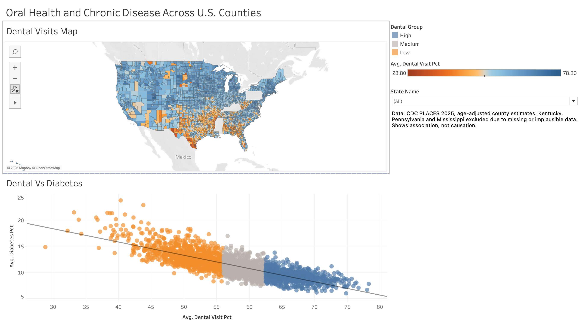
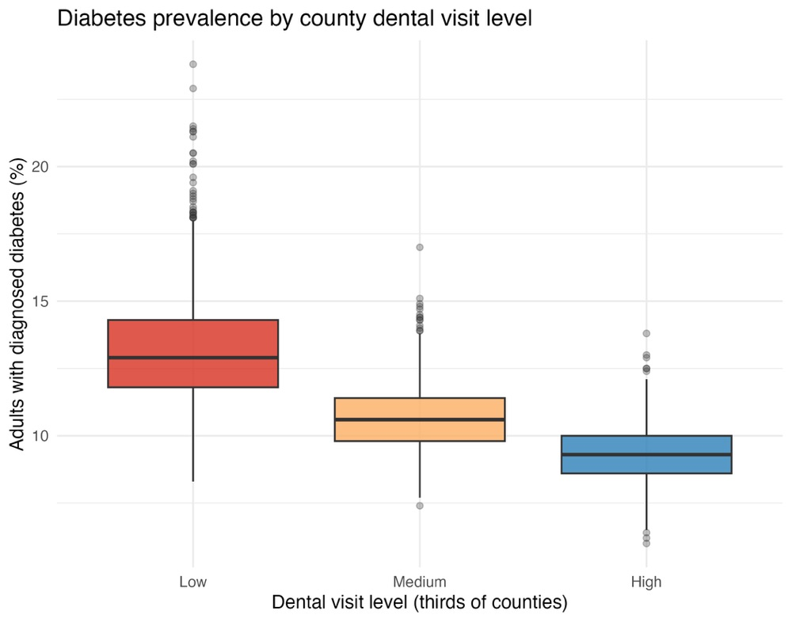
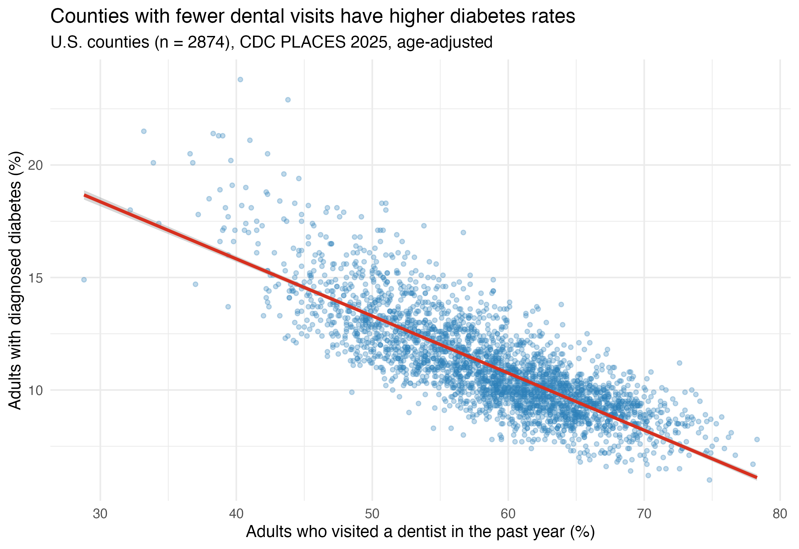
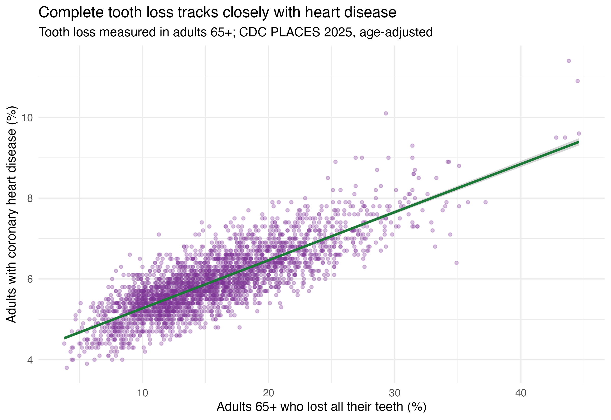

# Oral Health and Chronic Disease Across U.S. Counties

A population health analysis of the relationship between dental care access and chronic disease across 2,874 U.S. counties, built with **Python**, **R**, and **Tableau**.

🔗 **[View the interactive Tableau dashboard](https://public.tableau.com/app/profile/tanya.sharma1076/viz/oral_health_dashboard/OralHealthandChronicDiseaseAcrossU_S_Counties?publish=yes)**



---

## Overview

This project examines whether U.S. counties where fewer adults visit the dentist also have higher rates of diabetes and heart disease. Using the CDC PLACES 2025 county-level dataset, I cleaned and prepared the data in **Python (pandas)**, analyzed it statistically in **R**, and visualized the findings in an interactive **Tableau** dashboard.

The results show a strong negative association between dental visits and diabetes prevalence (**r = −0.81**). This association weakens substantially after adjusting for smoking, obesity, and lack of health insurance, which suggests that shared social and behavioral factors explain much of the pattern.

## Research Question

> Do counties where fewer adults visit the dentist have higher rates of diabetes and heart disease?

## Data

| | |
|---|---|
| **Source** | [CDC PLACES: County Data (GIS Friendly Format), 2025 release](https://data.cdc.gov/d/i46a-9kgh) |
| **Unit of analysis** | U.S. county |
| **Raw data** | 3,143 counties, 167 columns |
| **Analysis dataset** | 2,874 counties, 13 columns |
| **Measures** | Age-adjusted prevalence estimates (%) |

**Variables used:** dental visit in the past year, complete tooth loss (adults 65+), diagnosed diabetes, coronary heart disease, current smoking, obesity, and lack of health insurance (adults 18–64).

## Tools

| Tool | Purpose |
|---|---|
| **Python (pandas)** | Data cleaning, validation, and feature engineering |
| **R (tidyverse, ggplot2)** | Descriptive statistics, correlation, linear regression, and charts |
| **Tableau** | Interactive county map and dashboard |
| **Git / GitHub** | Version control and documentation |

## Methods

### 1. Data cleaning (Python)
- Selected 12 relevant measures out of 167 columns and renamed them for readability.
- Used **age-adjusted** rates so that counties with older populations can be compared fairly with younger ones.
- Converted population from text to numeric and zero-padded county FIPS codes to 5 digits for mapping.
- **Excluded Kentucky and Pennsylvania (187 counties):** most measures were missing in this data release.
- **Excluded Mississippi (82 counties):** every county reported dental visit rates of only 4.9–12.9%, against a national median of 59.3%. These values are not clinically plausible and point to a data issue for that state.
- Created a `dental_group` variable that splits counties into Low, Medium, and High dental visit thirds.

### 2. Statistical analysis (R)
- Descriptive statistics by measure and by state.
- Pearson correlation matrix across all measures.
- Two linear regression models predicting diabetes prevalence:
  - **Model 1:** dental visits only
  - **Model 2:** dental visits + smoking + obesity + lack of insurance

### 3. Visualization (R and Tableau)
- Three static charts built with ggplot2.
- An interactive Tableau dashboard with a county-level choropleth map, a scatter plot with a trend line, and a state filter.

## Key Findings

**1. Fewer dental visits go with more diabetes.**
Dental visit rates and diabetes prevalence are strongly negatively correlated (**r = −0.81**).

| Dental visit group | Average diabetes prevalence |
|---|---|
| Low | 13.2% |
| Medium | 10.7% |
| High | 9.3% |

**2. Much of the link is explained by shared risk factors.**
On its own, each 1-point increase in dental visit rate is associated with a **0.25-point** decrease in diabetes prevalence. After adjusting for smoking, obesity, and lack of insurance, this drops to **0.09 points**, about two-thirds smaller, though it remains statistically significant (p < 0.001). The adjusted model explains **77%** of the variation in diabetes rates between counties (R² = 0.77).

**3. Tooth loss tracks closely with heart disease.**
Counties with higher rates of complete tooth loss among older adults have higher rates of coronary heart disease (**r = 0.82**). This is consistent with known associations between periodontal disease, systemic inflammation, and cardiovascular disease.

**4. A clear geographic pattern.**
Dental visit rates are lowest in parts of the South and Texas (state averages: Arkansas 49.6%, Texas 51.0%, West Virginia 52.1%) and highest in New England (Rhode Island 73.3%, Connecticut 69.9%, Massachusetts 69.6%).

## Charts

| | |
|---|---|
|  |  |
|  | |

## Limitations

- **Association, not causation.** This is a cross-sectional, county-level (ecological) analysis. The results describe counties, not individual patients.
- **Model-based estimates.** PLACES values are small-area estimates modeled from survey and demographic data, not direct counts, so some correlation between measures may come from the modeling itself.
- **Different survey years.** Dental visit and tooth loss measures come from 2022 survey data; most other measures come from 2023.
- **Excluded states.** Kentucky, Pennsylvania, and Mississippi are not included, so results may not fully represent those regions.
- **Limited confounders.** Income, age structure, and rurality were not included in the model and may explain part of the remaining association.

## Repository Structure

```
oral-health-county-analysis/
├── README.md
├── requirements.txt
├── .gitignore
├── data/
│   ├── places_county_raw.csv          # Original CDC PLACES download
│   └── places_county_clean.csv        # Cleaned output from Python
├── scripts/
│   ├── clean_data.py                  # Step 1: data cleaning (Python)
│   └── analysis.R                     # Step 2: statistics and charts (R)
├── charts/
│   ├── 1_dental_vs_diabetes.png
│   ├── 2_diabetes_by_dental_group.png
│   ├── 3_toothloss_vs_heart_disease.png
│   └── dashboard_screenshot.png
└── tableau/
    └── oral_health_dashboard.twbx     # Tableau packaged workbook
```

## How to Run

Run both scripts from the main project folder.

**Python (data cleaning)**
```bash
python -m venv .venv
source .venv/bin/activate        # Windows: .venv\Scripts\activate
pip install -r requirements.txt
python scripts/clean_data.py
```

**R (analysis and charts)**
```r
install.packages("tidyverse")
setwd("path/to/oral-health-county-analysis")
source("scripts/analysis.R")
```

**Tableau**
Open `tableau/oral_health_dashboard.twbx` in Tableau Desktop or Tableau Public, or view the published dashboard using the link at the top of this page.

## Author

**Tanya Sharma**
Dentist (BDS) and M.S. Health Informatics student, Northeastern University
[LinkedIn](https://linkedin.com/in/tanya-sharma3) · [GitHub](https://github.com/Tanya-Sharma27)